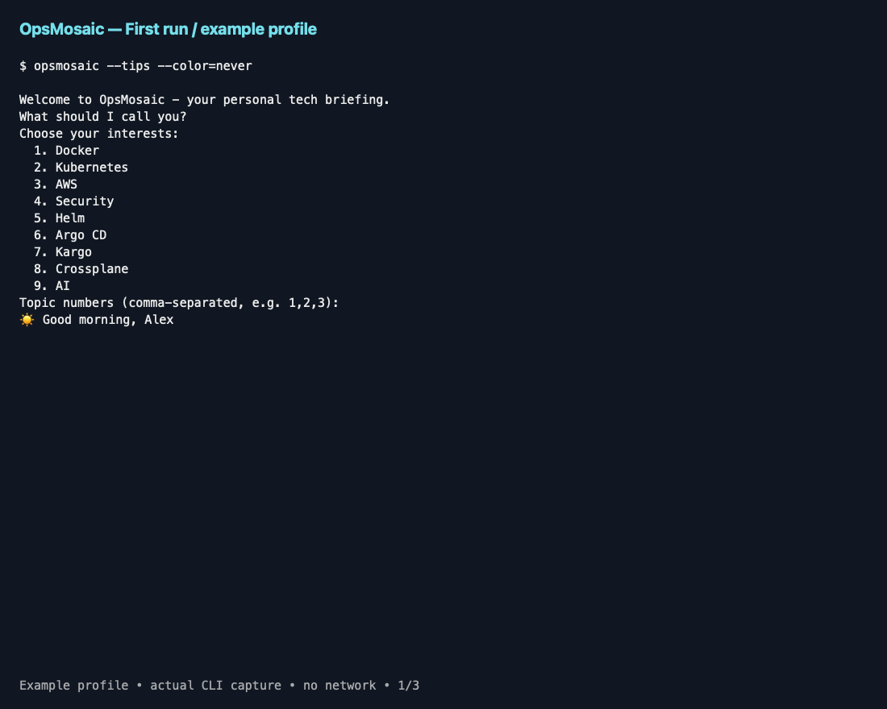

# OpsMosaic

**A little signal before your next command.**

A personal terminal briefing for DevOps, cloud, security, and AI. Choose your
interests, get practical tips and current headlines, and follow links to the
original sources. Built in Go with small terminal/Unicode display libraries:
no account, API key, external runtime, or AI subscription.
The AI topic selects AI-related news; it does not generate summaries. See the
[AI-summary decision](docs/ai-summaries.md).

## See it in action



[Text transcript and regeneration instructions](docs/demo/README.md).
This is actual CLI output rendered as a three-scene animation, using disposable
state and no network. The offline scene deliberately retains the empty-news
warning because no news cache is seeded.

## Install on macOS

Works on Apple Silicon and Intel Macs. Building requires Go 1.24 or newer and
`make`. The installed executable is standalone: Go is not needed to run it.

### 1. Install build tools

If needed, install [Homebrew](https://brew.sh/) using its official instructions.
Then install Go:

```sh
brew install go
```

If `git` or `make` is unavailable, install Apple's Command Line Tools:

```sh
xcode-select --install
```

### 2. Clone and install

Clone the project repository:

```sh
git clone https://github.com/D-Kumar19/opsmosaic.git
cd opsmosaic
make install
```

If you already have a local checkout, just run `make install` from its root.
This builds and copies the executable to `~/.local/bin/opsmosaic`, without
`sudo`. Once installed, you can run it from any directory; it does not depend
on the checkout or its `bin` folder.

### 3. Add the command directory to PATH

For macOS's default zsh, add this line to `~/.zshrc` once:

```sh
export PATH="$HOME/.local/bin:$PATH"
```

Reload the shell configuration, verify the installation, and launch:

```sh
source ~/.zshrc
command -v opsmosaic
opsmosaic
```

For bash, put the same PATH line in `~/.bash_profile` and reload that file.

### Homebrew tap status

Homebrew above installs the Go build tool, not OpsMosaic itself. There is
**no OpsMosaic tap planned**, so no `brew tap` / `brew install opsmosaic`
command is advertised as working. `make install` is the supported path.

### Updating, custom locations, and uninstalling

Update your checkout and reinstall:

```sh
git pull --ff-only
make install
```

Reinstalling replaces the executable, not your saved name, interests, or cache.
You can choose another writable prefix, for example:

```sh
make install PREFIX="$HOME/Applications/opsmosaic"
export PATH="$HOME/Applications/opsmosaic/bin:$PATH"
```

For the default installation, uninstall with:

```sh
rm "$HOME/.local/bin/opsmosaic"
```

This leaves your preferences/cache intact. For a custom prefix, remove only
the `opsmosaic` executable at that prefix.

## Bookmarks and replay

```sh
opsmosaic replay                    # Last complete briefing, no new greeting
opsmosaic bookmarks add             # Save the last single item
opsmosaic bookmarks add 2           # Explicit item number for a multi-item run
opsmosaic bookmarks list
opsmosaic bookmarks show <ID> --plain
opsmosaic bookmarks remove <ID>
```

Saved output retains its original source/link and capture time, is labeled
**saved, not live news**, and never fetches or advances history/greetings.
Bookmarks persist independently of feed cache until removed (maximum 100,
no automatic eviction). See [storage and duplicate rules](docs/bookmarks.md).

## First run

Enter your own name (shown below as `<YOUR NAME>`). In an interactive macOS or
Linux terminal,
move through the topics with the arrow keys, press Space to select or deselect,
and Enter to continue. Press `q` or Ctrl-C to cancel without saving changes.
Piped/non-interactive input keeps the numbered topic prompt.

```text
What should I call you? <YOUR NAME>

Choose your interests, <YOUR NAME>
Use ↑/↓ to move, Space to select, Enter to continue; q or Ctrl-C cancels.
Select one or more topics:
   [ ] Docker
 > [x] Kubernetes
   [x] AWS
   [x] Security
   [ ] Helm
   [ ] Argo CD
   [ ] Kargo
   [ ] Crossplane
   [x] AI
```

Runs greet you with your name, local date/time and timezone, plus a small
time-aware comment. For example:

```text
☀️ Good morning, <YOUR NAME>!
☕ Need a coffee? Here's a little signal to start your day.
🕒 Wednesday, 14 October 2026 | 09:00 CEST
```

Greetings follow your device's local time:

| Hours | Greeting |
|---|---|
| 05:00-11:59 | ☀️ Good morning |
| 12:00-16:59 | 🌤️ Good afternoon |
| 17:00-21:59 | 🌆 Good evening |
| 22:00-04:59 | 🦉 Hey night owl |

Each period has three playful comments that rotate on successful briefings.
The rotation persists locally, including in tips-only and offline modes.
Older caches work without resetting your profile. No AI service generates
these messages, and failed displays do not advance the rotation.
Emoji appearance depends on your terminal's font support.

By default,
each run shows **one random item**: a tip, news headline, or release matching
your interests. The app chooses equally among available content kinds, then
randomly chooses an unseen item within that kind when possible. Once all items
in that kind have been shown, repeats are allowed. This keeps tips eligible
even when busy news feeds have lots of unseen headlines.

`--tips` and `--news` restrict the random choice; `--topic` restricts interests.
Only an explicit `--count` greater than one enables a multi-item briefing.
Those larger briefings retain balanced topic selection and duplicate filtering;
mixed mode shows one tip followed by available news/releases.

```sh
opsmosaic --tips
opsmosaic --news --topic ai,security
opsmosaic --news --topic helm,argocd --stable-only
opsmosaic --topic kubernetes,helm --count 5
opsmosaic --offline
opsmosaic refresh
opsmosaic config
opsmosaic --help
opsmosaic --version
opsmosaic doctor
opsmosaic doctor --json
opsmosaic feeds list
opsmosaic --detailed
opsmosaic --plain
opsmosaic --color=never
```

`--count` is the maximum total number of items (1-20; default 1), not the number of
headlines in addition to a tip. A topic override does not change saved
preferences. Topic slugs are:
`docker,kubernetes,aws,security,helm,argocd,kargo,crossplane,ai`.
Options follow the optional subcommand. `config` takes no briefing options.
`refresh` cannot be combined with `--tips` or `--offline`.

### Display modes

Compact output is the default: greeting, rotating comment, local time, content,
source/date/freshness, and link. `--detailed` adds the application heading,
terminal-width dividers, and interests/count footer; it does not change how
many content items are selected.

Prose wraps to the detected terminal width with Unicode grapheme-aware widths
for emoji, CJK and combining characters. If size detection is unavailable,
the fallback is 80 columns. Commands and URLs are never split by the renderer,
so they remain copyable; your terminal may naturally soft-wrap them. An
individual grapheme wider than an extremely narrow terminal cannot be split.

On capable interactive terminals, headings use cyan, greetings warm yellow,
and metadata is dimmed. `--color=auto|always|never` controls styling.
`--plain` disables decorative emoji, borders, and color. Non-TTY output
(pipes/files), `TERM=dumb`, and missing `TERM` automatically use plain output,
even with `--color=always`. Plain output retains personalized text and time;
it does not remove Unicode names or emoji that are part of an article title.
A nonempty `NO_COLOR` environment variable disables color even with `always`,
but keeps decorative emoji in interactive output unless `--plain` is also used.
An empty `NO_COLOR` does not disable color.

```sh
NO_COLOR=1 opsmosaic
opsmosaic --detailed --plain
opsmosaic --tips > briefing.txt
```

### Alternative: install using Go directly

From the checkout, you can install into Go's configured binary directory
instead of using `make install`:

```sh
go install ./cmd/opsmosaic
# Ensure $(go env GOPATH)/bin (or your GOBIN) is on PATH.
opsmosaic
```

## Optional terminal startup and background refresh

For installation/profile/cache problems, run `opsmosaic doctor` or
`opsmosaic doctor --json`. These [local diagnostics](docs/doctor.md) never fetch,
onboard or change state. Missing/stale data warns; corrupt/unreadable state
fails explicitly. Home paths are abbreviated, but review output before sharing.

Opt-in zsh/bash setup/removal and macOS refresh every three hours are available.
Nothing is enabled automatically. See [shell and scheduling instructions](docs/shell-integration.md)
before running setup commands, especially if you already have a manual hook.
Terminal greetings stay offline; scheduled jobs update cache without advancing
display history or greeting rotation. Existing personal shell files are unchanged.

## Sources and safety

Add public, unauthenticated RSS/Atom sources using
[`opsmosaic feeds add/list/remove`](docs/custom-feeds.md). Custom feeds
supplement built-ins and map to existing topics as news or releases. Up to 20
are allowed; HTTPS/443 without credentials, queries or private/local destinations
is required. Cached custom items work offline and participate in scheduled refresh.

| Topic | Source | Content |
|---|---|---|
| Docker | [Docker blog](https://www.docker.com/blog/feed/) | News |
| Kubernetes | [Kubernetes blog](https://kubernetes.io/feed.xml) | News |
| AWS | [AWS What's New](https://aws.amazon.com/about-aws/whats-new/recent/feed/) | News |
| Security | [CISA advisories](https://www.cisa.gov/cybersecurity-advisories/all.xml) | Advisories |
| Helm | [Helm releases](https://github.com/helm/helm/releases.atom) | Releases |
| Argo CD | [Argo CD releases](https://github.com/argoproj/argo-cd/releases.atom) | Releases |
| Kargo | [Kargo releases](https://github.com/akuity/kargo/releases.atom) | Releases |
| Crossplane | [Crossplane releases](https://github.com/crossplane/crossplane/releases.atom) | Releases |
| AI | [Hacker News API](https://github.com/HackerNews/API) | Title-filtered top stories |

AI coverage scans at most 30 HN top stories using AI-related title keywords:
it is deliberately lightweight, not an exhaustive or authoritative AI news
index. A feed can have no matching stories. Release feeds may include
prereleases; the upstream version label is preserved.

Use `--stable-only` to exclude prerelease and unknown-format **RELEASE** items
for that run. Tips and news are unaffected, including articles about beta
versions. Defaults still include upstream prereleases. The filter applies to
built-in/custom feeds, offline cache and explicit refresh without deleting
anything from cache or changing your preferences.

Recognition is conservative: an explicit `/releases/tag/` URL takes precedence
over the title. Otherwise the complete title must be a stable SemVer label,
optionally starting with `Release `. Supported examples include `v1.2.3`,
`1.2.3+build.1`, `helm-v3.16.0`, `component/v1.2.3` and `component@1.2.3`.
Component prefixes use ASCII letters/digits/underscores/hyphens; arbitrarily
nested prefixes, dates, prose and incomplete versions are excluded.
Prerelease suffixes and alpha/beta/RC/nightly/dev/snapshot/preview prefix
markers are excluded. This recognizes version labels, not a publisher's
stability guarantee. If news-only mode has no matching items, it fails
explicitly; mixed mode can still show a tip with an empty-news warning.

News contains headlines, source attribution, timestamps when available, and
links, not copied article bodies or AI summaries. Respect publishers' terms.
Tips are bundled and read-only; some require installed CLIs, authentication,
CRDs, or cluster permissions. Commands are printed, **never executed**.
External text is sanitized and non-HTTP(S) links are rejected.

## Caching and privacy

Each source is cached for six hours. Stale sources refresh on a normal run;
`refresh` bypasses the TTL. Fetches have time and response-size limits.
Source failures print warnings to stderr and retain older cached items.
Individual Hacker News story failures preserve the successful results, merged
with older cached stories, deduplicated and capped at 100 items. A partial
fetch prints a warning and retries after 15 minutes rather than six hours;
`refresh` bypasses that wait. A complete failure leaves the source cache intact.

Cached headlines show their cache age (for example, `cached 2h ago`); they are
marked `stale` at six hours. Cache age is the last retrieval time, not the
article's publication age. Older entries retained during a partial fetch keep
their original retrieval time. Unknown or future cache timestamps are labeled
`cache age unknown | stale`, rather than treated as fresh. Stale headlines are
not hidden; selecting one prints a single `opsmosaic refresh` hint on stderr
per briefing, even when several stale items are shown.

An empty news-only briefing exits
with an error; a normal briefing can still show a tip with an empty-news
warning. `--tips` and `--offline` make no network requests.

State is local, versioned JSON, atomically replaced with owner-only file
permissions:

- Config: OS user-config directory / `opsmosaic/config.json`.
- Cache/history: OS user-cache directory / `opsmosaic/cache.json`.
- macOS defaults: `~/Library/Application Support/opsmosaic/config.json` and
  `~/Library/Caches/opsmosaic/cache.json`.
- `OPSMOSAIC_HOME=/some/directory` places both files in one chosen directory.
- A persistent `config.json.lock` file beside the profile coordinates state
  access on macOS/Linux. Its existence does not mean a process holds the lock;
  the OS releases the lock when a process exits, even after an abrupt exit.
  Do not delete this file while OpsMosaic is running.

Your name and interests are not sent to a hosted backend. Selected feed
providers see normal requests from your IP address. No telemetry is added.
Corrupt state produces an explicit error; use `config` to replace a bad
profile, or move a bad cache aside to rebuild it. State updates and refreshes
hold a cross-process lock. Another invocation waits up to 250 ms, then shows
a read-only snapshot with a warning: no HTTP requests, history/greeting updates,
or cache/profile writes. `refresh` also uses this fallback if the lock is busy,
so check its warning before assuming a refresh happened. Preference editing
instead fails explicitly when busy; a missing profile never starts a second
onboarding session while another process holds the lock. This lock support is
currently limited to macOS/Linux and assumes normal local filesystem semantics.

No shell startup hook is installed. For an opt-in, network-free greeting,
you can later add `opsmosaic --offline` to your interactive shell setup after
completing onboarding.

## Development and tests

```sh
go test ./...
go test -race -cover ./...
go vet ./...
go build -o bin/opsmosaic ./cmd/opsmosaic
make test-install
make ci
make test-release
```

Tests use temporary directories and `httptest` servers: no live internet,
third-party executables, or real user configuration is needed. Concurrency tests
spawn copies of the Go test executable to verify actual cross-process locking.
The separate installation test requires Go, `make`, and standard Unix tools;
it installs into temporary directories, verifies `opsmosaic` through PATH from
outside the checkout, and cleans up its temporary installation and profile.
It also tests custom prefixes containing spaces and staged installation.
See [test cases](docs/testing.md), [project context](docs/spec.md),
[architecture](docs/architecture.md), [principles](docs/constitution.md),
and [implementation TODOs](docs/plan.md).

The topic picker supports arrow-key selection with a numbered non-TTY fallback.
The renderer uses
[`x/term`](https://pkg.go.dev/golang.org/x/term) for terminal detection and
[`uniseg`](https://pkg.go.dev/github.com/rivo/uniseg) for Unicode display widths;
their Go dependencies are compiled into the standalone executable.
Custom feeds are supported; remote CI and release publishing remain outstanding.

## Versioning, releases, and contributions

OpsMosaic is a personal project hosted at
[D-Kumar19/opsmosaic](https://github.com/D-Kumar19/opsmosaic).
Source builds report `dev`; `opsmosaic --version`
shows version, commit and build time without onboarding or network requests.

`v0.1.0` is the proposed first release, not an existing tag. Local archives for
macOS/Linux arm64/amd64 can be generated from a clean committed checkout using
`make release VERSION=v0.1.0`. Packaging does not tag, push or upload anything.
See [release policy and verification](docs/releases.md) before distribution.
Cross-compiled targets are not yet native-runtime-certified.

`make ci` runs portable checks locally. Remote GitHub Actions wiring and
successful/failing run verification are still outstanding; there is no live CI badge or claimed
remote matrix result. See [CI readiness](docs/ci.md).

See [contributor instructions](CONTRIBUTING.md), [changelog](CHANGELOG.md),
and the [MIT source-code license](LICENSE). The code license does not cover
third-party article bodies. Release publication requires maintainer approval.

The [project summary](docs/project-summary.md) explains design trade-offs and
measured verification. [Draft release notes](docs/release-notes.md) are not an
announcement of an available release.

[Optional local OpenSSH signing tools](docs/signing.md) are prepared and tested
with disposable keys. No production signing identity or signed release exists.
